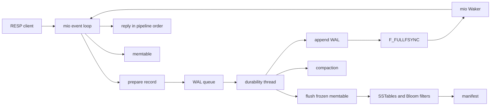
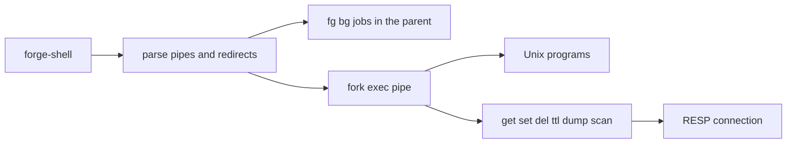

# Forge

Forge is a small persistent key-value store. One process serves a RESP2 subset and an HTTP admin port. A separate `forge-shell` binary speaks that subset and runs Unix pipelines.

A write is acknowledged only after the WAL `fsync` returns. On macOS that call is `F_FULLFSYNC`. Other connections do not see the write until that same `fsync` has returned. The event-loop thread does not call `fsync`. If `fsync` returns an error, Forge stops acknowledging writes and exits. It does not retry and continue.

## Layout



`mio` uses kqueue on macOS and epoll on Linux. This machine ran the kqueue build. epoll was not run.

The durability thread appends a group of records, calls `F_FULLFSYNC` once, then wakes the event loop. The loop applies the group and sends the replies in the order the commands arrived. A read that follows an unacked write on the same connection waits. A read with no earlier unacked write does not.

Expired and deleted keys are tombstones with absolute expiry timestamps. Compaction must not revive them from an older SSTable. The clock is injected, so replay does not move an expiry.



## Commands

Protocol tests cover `GET`, `SET` (optional `EX`), `DEL`, `EXPIRE`, `TTL`, `PING`, and `SCAN` (`MATCH`, `COUNT`). The server also accepts `DUMP`, `SELECT 0`, `INFO`, `COMMAND`, `ECHO`, and `QUIT` so `redis-benchmark` and the shell can connect. There is no pub/sub, modules, or cluster mode.

`forge-shell` builtins are `get`, `set`, `del`, `ttl`, `dump`, and `scan`. Pipes, `<`, `>`, `>>`, and a trailing `&` use `fork`, `exec`, and `pipe`. `fg`, `bg`, and `jobs` run in the parent. A builtin in a pipeline runs in the child.

HTTP/1.1, with no framework: `GET /health`, `GET /metrics`, `GET /key/<percent-encoded>`. Oversized headers and bulk strings are rejected.

## Build and test

```sh
cargo test --workspace
```

`cargo test` on this Mac runs the 50-seed crash suite plus a few fresh seeds. The 2,000-run suite is compiled only on Linux, ignored unless `FORGE_FULL_CRASH=1`, and was not run here.

```sh
cargo run -p forge-server --release -- --data /tmp/forge-data --redis 127.0.0.1:6379 --http 127.0.0.1:8080
cargo run -p forge-shell -- --port 6379 -c 'set k v'
```

Named failpoints: `after_wal_append`, `after_fsync_before_ack`, `mid_flush`, `after_manifest_write`, `mid_compaction`, `after_new_wal_before_manifest`. `FORGE_FAILPOINT` makes the binary exit 77 at that point. The in-memory disk records fsynced ranges and can drop the rest.

## Benchmark

`redis-benchmark` 8.6.1 against a release `forge-server`. Every `SET` waits for `F_FULLFSYNC` before `+OK`. Hardware: Apple M5 (Mac17,3), 10 cores, 16 GB, Darwin 27.0.0 arm64, APFS on an Apple Fabric SSD. Payload 32 bytes, 16 clients, keep-alive. Warm-up for the pipeline-depth 1 `SET` was 400 `SET` requests at the same client count, pipeline depth, and payload. Commands are in `scripts/bench.sh`.

`sample` for 3 seconds (1 ms interval) during `SET` at pipeline depth 1, before the span-list edit below: the durability thread had 1291 samples, 1065 of them in `fcntl` inside `F_FULLFSYNC`. The largest userspace stack beside that was `mark_spans_synced` comparing span file names (`memcmp`, 93 samples). The event-loop thread was mostly in `kevent`. Commit `cfddf591219ae3aaad28e4176d4aa95ddc9490f2` stops recording a sync-range string on every real `fsync` and drops already-synced spans once the list is longer than 4096.

That edit did not produce a stable p95 change, so none is claimed. On the committed binary, two fresh runs of `SET` (`-c 16 -P 1 -d 32 -n 3000`) after the 400-request warm-up were:

| run | requests/sec | window | p50 | p95 | p99 |
|---|---:|---:|---:|---:|---:|
| 1 | 2354.79 | 1.27 s | 6.759 ms | 8.279 ms | 9.871 ms |
| 2 | 2033.90 | 1.48 s | 7.919 ms | 8.951 ms | 9.495 ms |

The same process, after run 1, then ran:

| test | requests/sec | window | p99 |
|---|---:|---:|---:|
| `GET -c 16 -P 1 -d 32 -n 8000` | 72727.27 | 0.11 s | 1.815 ms |
| `SET -c 16 -P 16 -d 32 -n 20000` | 28571.43 | 0.70 s | 12.911 ms |

`GET` does not fsync. The 0.11 s window is the whole measured run.

## Conclusion

Unsynced writes were dropped in the fsync simulation, and no acknowledged write was unsynced, on commit `cfddf591219ae3aaad28e4176d4aa95ddc9490f2`.
No observed value was absent from the recovered history on commit `cfddf591219ae3aaad28e4176d4aa95ddc9490f2`.
Implements a subset of RESP2: `GET`, `SET`, `DEL`, `EXPIRE`, `TTL`, `PING`, `SCAN`.
Sustained 2033.90 ops/sec for 1.48 seconds after a 400-request warm-up, p99 9.495 ms, on an Apple M5, Darwin 27.0.0, APFS, with fsync-before-ack and pipeline depth 1. 16 clients, 32-byte values, `SET` only. An earlier pass on a fresh directory was 2354.79 ops/sec for 1.27 seconds, p99 9.871 ms.
Sustained 28571.43 ops/sec for 0.70 seconds, p99 12.911 ms, on the same machine, with fsync-before-ack and pipeline depth 16. 16 clients, 32-byte values, `SET` only, after the pipeline-depth 1 run and an 8000-request `GET` on that process.
Detects torn and corrupted WAL records using checksums (9 scripted fault cases: torn WAL tail, WAL bit flip, SSTable bit flip, dropped newest manifest, half-written SSTable, `fsync` error, disk full, short write, crash after the new WAL file and before the manifest).
Tested on kqueue (macOS, `F_FULLFSYNC`). The 2000-run suite is Linux-only and was not run. epoll was not run.

`sample` on the durability thread put 1065 of 1291 samples in `F_FULLFSYNC`. That is the bottleneck. The span-list edit did not hold a lower p95 across the two fresh `SET` runs above, so this note does not claim a latency reduction.

Limit: process kills and the fsync shim test the software. They do not test a drive that loses its cache. `fsync` guarantees differ between Linux and macOS.
